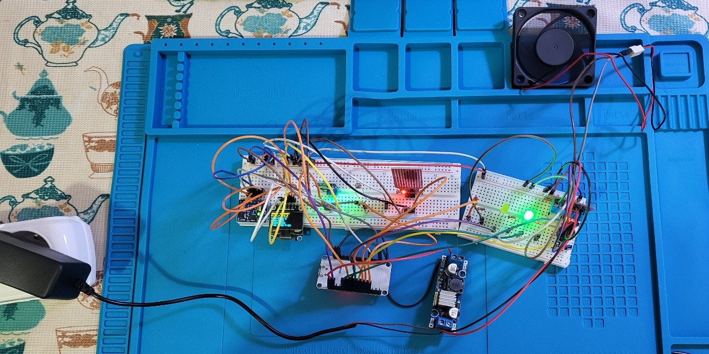
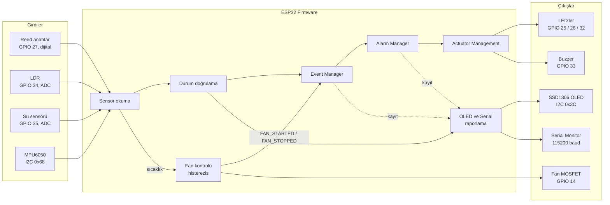
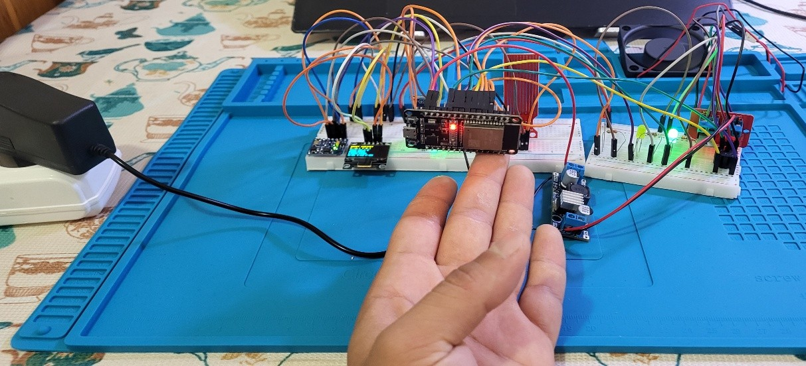
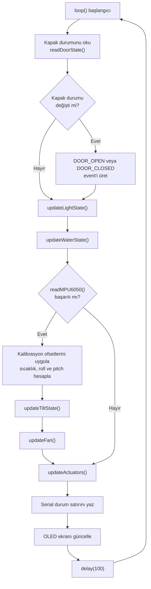
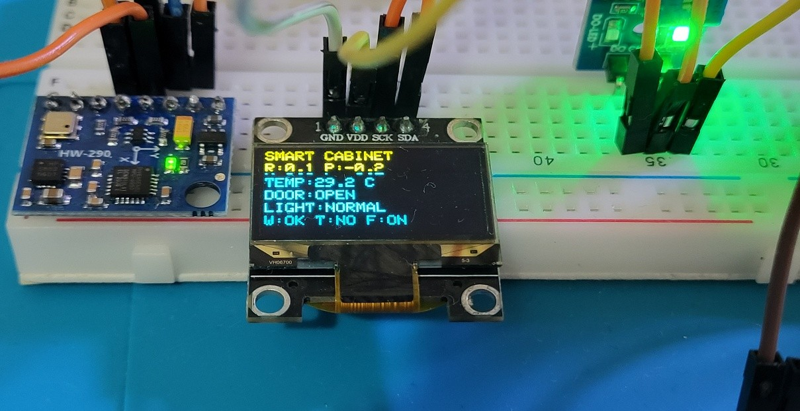
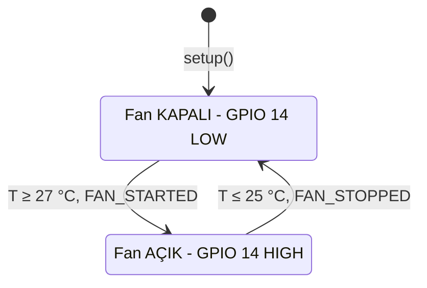

# Smart Field Cabinet System

**Akıllı Saha Dolabı İzleme ve Alarm Sistemi (Prototip)**

Smart Field Cabinet System, dış ortamdaki saha dolaplarını (field cabinet) izlemek için geliştirilmiş, ESP32 tabanlı bir gömülü sistem (embedded system) prototipidir. Sistem dolabın kapak durumunu, eğimini, su varlığını, ışık seviyesini ve sıcaklığını izler. Kritik durumlarda yerel alarm üretir ve dolap içi fanı otomatik olarak yönetir.

| Başlık | Bilgi |
| --- | --- |
| Mikrodenetleyici | ESP32 (Arduino çatısı / Arduino framework) |
| Ana firmware dosyası | `Smart-Field-Cabinet-System.ino` (tek dosya) |
| Geliştirme ortamı | Arduino IDE 2.x, Espressif ESP32 kart paketi |
| Sensörler | Reed anahtar, LDR, analog su sensörü, MPU6050 |
| Çıkışlar | Yeşil / sarı / kırmızı LED, buzzer, MOSFET ile sürülen fan, SSD1306 OLED |
| Haberleşme | I2C (SDA: GPIO 21, SCL: GPIO 22), USB üzerinden Serial (115200 baud) |
| Ağ bağlantısı | Mevcut sürümde bulunmuyor |
| Proje durumu | Prototip |

> [!NOTE]
> Bu doküman, `Smart-Field-Cabinet-System.ino` dosyasının mevcut içeriği esas alınarak hazırlanmıştır. Doğrulanmış bir elektriksel bağlantı şeması henüz bulunmadığından, donanım bağlantılarına ilişkin bilgiler firmware'deki tanımlardan çıkarılmıştır. Dokümandaki prototip fotoğrafları gerçek montajı gösterir; ancak doğrulanmış bir bağlantı şeması yerine geçmez.

---

## İçindekiler

1. [Proje Tanıtımı](#1-proje-tanıtımı)
2. [Temel Özellikler](#2-temel-özellikler)
3. [Sistem Mimarisi](#3-sistem-mimarisi)
4. [Donanım Bileşenleri](#4-donanım-bileşenleri)
5. [GPIO Pin Eşleştirmeleri](#5-gpio-pin-eşleştirmeleri)
6. [Yazılım Mimarisi](#6-yazılım-mimarisi)
7. [Event ve Alarm Mekanizması](#7-event-ve-alarm-mekanizması)
8. [Fan Kontrol Algoritması](#8-fan-kontrol-algoritması)
9. [Arduino IDE Kurulumu](#9-arduino-ide-kurulumu)
10. [Arduino Kütüphanelerinin Kurulumu](#10-arduino-kütüphanelerinin-kurulumu)
11. [Firmware Yükleme](#11-firmware-yükleme)
12. [İlk Çalıştırma ve Test Senaryoları](#12-ilk-calistirma-ve-test-senaryolari)
13. [Teknik Sınırlamalar](#13-teknik-sınırlamalar)
14. [Gelecek Geliştirmeler](#14-gelecek-geliştirmeler)
15. [Proje Dosya Yapısı](#15-proje-dosya-yapısı)
16. [Lisans](#16-lisans)

---

## 1. Proje Tanıtımı

### 1.1 Smart Field Cabinet System Nedir?

Smart Field Cabinet System, saha dolaplarının fiziksel durumunu izleyen ve ESP32 mikrodenetleyicisi üzerinde çalışan bir izleme ve alarm sistemidir.

Sistem, dolaba yerleştirilen sensörlerden kapak durumu, dolap eğimi, su varlığı, ışık seviyesi ve sıcaklık bilgisini periyodik olarak okur. Okunan veriler doğrulandıktan sonra olaylara (event) dönüştürülür; kritik olaylar alarm üretir. Sonuçlar LED'ler, buzzer, OLED ekran ve Serial Monitor üzerinden yerel olarak bildirilir. Dolap içi fan, sıcaklık bilgisine göre otomatik olarak açılıp kapatılır.

<p align="center">
  
</p>
<p align="center"><em>Smart Field Cabinet System prototipinin genel görünümü.</em></p>

### 1.2 Çözülmesi Hedeflenen Problem

Saha dolapları çoğunlukla insansız (unattended) çalışır ve birbirinden uzak konumlarda bulunur. İçlerindeki elektronik ekipman aşağıdaki risklere açıktır. Bu risklerin yerinde algılanamaması, arızanın veya izinsiz müdahalenin geç fark edilmesine yol açar.

| Risk | Algılama yöntemi | Mevcut firmware tepkisi |
| --- | --- | --- |
| Dolap kapağının açılması | Reed anahtar (manyetik kontak) | `UNAUTHORIZED_ACCESS` kritik alarmı |
| Dolabın eğilmesi veya devrilmesi | MPU6050 ivmeölçer (accelerometer) | `CABINET_TILTED` kritik alarmı |
| Dolap içine su girmesi | Analog su sensörü | `HIGH_WATER` kritik alarmı |
| Dolap içi sıcaklığın artması | MPU6050 dahili sıcaklık sensörü | Fanın otomatik çalıştırılması (alarm üretilmez) |
| Dolap içi ışık seviyesinin değişmesi | LDR (fotodirenç) | Event kaydı (alarm üretilmez) |

### 1.3 Hedeflenen Kullanım Alanları

Sistem, elektronik ekipman barındıran ve sahada insansız çalışan dolaplar için tasarlanmıştır. Örnek dolap türleri:

- Telekomünikasyon ve ağ dağıtım dolapları
- Güvenlik kamerası ve kent izleme sistemlerine ait saha dolapları
- Trafik sinyalizasyon kontrol dolapları
- Enerji dağıtım ve otomasyon panoları

### 1.4 Mevcut Prototip Kapsamı

| Kapsam içinde | Kapsam dışında (mevcut sürüm) |
| --- | --- |
| Tek ESP32 üzerinde çalışan, tek dosyadan oluşan firmware | Ağ bağlantısı (Wi-Fi, Ethernet vb.) |
| Kapak, eğim, su ve ışık algılama; MPU6050 üzerinden sıcaklık okuma | Merkezi sunucu, HTTP API ve dashboard |
| Doğrulama sayaçlarıyla durum tespiti, event ve alarm yönetimi | Event ve alarm kayıtlarının kalıcı olarak saklanması |
| LED, buzzer, OLED ve Serial Monitor ile yerel bildirim | Ortam sıcaklığı ve nem ölçümü |
| Histerezis tabanlı fan aç/kapa kontrolü | Fan hız kontrolü ve fan dönüş geri bildirimi |

Kapsam dışındaki maddeler için [Teknik Sınırlamalar](#13-teknik-sınırlamalar) ve [Gelecek Geliştirmeler](#14-gelecek-geliştirmeler) bölümlerine bakınız.

---

## 2. Temel Özellikler

Bu bölümde listelenen özelliklerin tamamı mevcut firmware'de uygulanmıştır.

| Özellik | Uygulama biçimi | Karar kuralı ve davranış |
| --- | --- | --- |
| Kapak açılma algılama | Reed anahtar, GPIO 27 dijital okuma | Pin `HIGH` ise kapak açık kabul edilir. Her durum değişiminde `DOOR_OPEN` veya `DOOR_CLOSED` event'i üretilir. |
| Eğim algılama (tilt detection) | MPU6050 ivme verisinden roll ve pitch açısı hesabı | Roll veya pitch mutlak değeri art arda 5 okumada 15°'nin üzerindeyse `CABINET_TILTED` event'i üretilir. |
| Su algılama | Su sensörü, GPIO 35 analog okuma (12 bit) | ADC değeri art arda 5 okumada 275'in üzerindeyse `WATER_DETECTED` event'i üretilir. |
| Işık algılama | LDR, GPIO 34 analog okuma (12 bit) | ADC değeri art arda 5 okumada 33'ün üzerindeyse `LIGHT_HIGH` event'i üretilir. |
| Sıcaklık verisi | MPU6050'nin dahili sıcaklık sensörü (I2C) | `T = TEMP_OUT / 340 + 36.53` formülüyle °C cinsinden hesaplanır. |
| Histerezis tabanlı fan kontrolü | GPIO 14 üzerinden MOSFET sürme | T ≥ 27 °C olduğunda fan açılır, T ≤ 25 °C olduğunda kapanır. |
| OLED ekran | SSD1306, 128×64 piksel, I2C adresi `0x3C` | Açı, sıcaklık ve durum bilgileri her döngüde yenilenir. |
| LED ve buzzer uyarıları | GPIO 25 (yeşil LED), GPIO 32 (kırmızı LED), GPIO 33 (buzzer) | Etkin kritik alarm varsa kırmızı LED yanar ve buzzer çalışır; yoksa yeşil LED yanar. |
| Olay yönetimi (Event Management) | `generateEvent()`, `processEvent()` | 10 event türü tanımlıdır; her event Serial çıktısına yazılır. |
| Alarm yönetimi (Alarm Management) | `setAlarm()`, `getAlarmSeverity()` | 3 alarm türü etkindir; tamamı `CRITICAL` önem seviyesindedir. |
| Serial Monitor ile sistem takibi | 115200 baud | Her döngüde bir durum satırı; event ve alarm değişimlerinde ayrı kayıt satırları yazılır. |

> [!IMPORTANT]
> Firmware'de tanımlı olduğu hâlde hiçbir koşulda tetiklenmeyen öğeler mevcut özellik olarak değerlendirilmemelidir: `HIGH_TEMPERATURE`, `VANDALISM`, `HIGH_HUMIDITY` ve `FAN_FAILURE` alarmları ile sarı LED. Ayrıntılar için [Teknik Sınırlamalar](#13-teknik-sınırlamalar) bölümüne bakınız.

---

## 3. Sistem Mimarisi

Sistem üç katmandan oluşur:

1. **Girdi katmanı (sensörler):** Reed anahtar, LDR ve su sensörü ESP32 GPIO pinleri üzerinden okunur. MPU6050 ise I2C veri yolu üzerinden okunur.
2. **İşlem katmanı (ESP32 firmware):** Sensör verilerini okur ve doğrular, event ve alarm üretir, fanı ve uyarı çıkışlarını yönetir.
3. **Çıkış katmanı:** LED'ler, buzzer ve fan MOSFET'i GPIO çıkışlarıyla sürülür. OLED ekran I2C üzerinden, Serial Monitor ise USB-seri bağlantı üzerinden beslenir.

MPU6050 ve SSD1306 OLED, aynı I2C veri yolunu (`Wire`; SDA: GPIO 21, SCL: GPIO 22) farklı adreslerle paylaşır.

### 3.1 Mantıksal Blok Diyagramı

> [!NOTE]
> Aşağıdaki diyagram, firmware içindeki veri akışını gösteren **mantıksal** bir diyagramdır. Fiziksel bağlantı (kablolama) şeması değildir.



### 3.2 Donanım ve Yazılım İlişkisi

| Donanım | Okuyan / süren fonksiyon | Üretilen event'ler | İlgili alarm | Gösterim |
| --- | --- | --- | --- | --- |
| Reed anahtar | `readDoorState()` | `DOOR_OPEN`, `DOOR_CLOSED` | `UNAUTHORIZED_ACCESS` | OLED `DOOR:`, Serial `DOOR:` |
| MPU6050 (ivme) | `readMPU6050()`, `updateTiltState()` | `CABINET_TILTED`, `CABINET_TILT_CLEARED` | `CABINET_TILTED` | OLED `R:` `P:` `T:`, Serial `ROLL:` `PITCH:` `TILT:` |
| MPU6050 (sıcaklık) | `readMPU6050()`, `updateFan()` | `FAN_STARTED`, `FAN_STOPPED` | — | OLED `TEMP:` `F:`, Serial `TEMP:` `FAN:` |
| Su sensörü | `readWaterSensor()`, `updateWaterState()` | `WATER_DETECTED`, `WATER_CLEARED` | `HIGH_WATER` | OLED `W:`, Serial `WATER:` |
| LDR | `readLDR()`, `updateLightState()` | `LIGHT_HIGH`, `LIGHT_NORMAL` | — | OLED `LIGHT:`, Serial `LDR:` |
| Yeşil, sarı, kırmızı LED ve buzzer | `updateActuators()` | — | Etkin kritik alarmlar | — |
| Fan MOSFET | `updateFan()` | — | — | — |
| SSD1306 OLED | `display` nesnesi (`setup()` ve `loop()`) | — | — | — |

### 3.3 Fiziksel Bağlantı Şeması

> **[Görsel yer tutucu] Fiziksel bağlantı şeması**
>
> Doğrulanmış bağlantı şeması hazırlandığında bu bölüme eklenecektir. Şema eklenene kadar [GPIO Pin Eşleştirmeleri](#5-gpio-pin-eşleştirmeleri) bölümündeki tablo yalnızca firmware'deki pin tanımlarını yansıtır.

Prototipin fiziksel bağlantılarını gösteren fotoğraf [4.4 Prototip Bağlantı Fotoğrafı](#44-prototip-bağlantı-fotoğrafı) alt bölümünde yer alır. Bu fotoğraf bir elektriksel şema değildir ve bu bölümdeki şemanın yerine geçmez.

---

## 4. Donanım Bileşenleri

Aşağıdaki tablo, firmware'in kullandığı bileşenleri listeler. "Bilinen model / teknik bilgi" sütununda yalnızca kaynak kodundan doğrulanabilen bilgiler yer alır. Belgelenmemiş modeller tahmin edilmemiştir.

| # | Bileşen | Görev | Firmware arayüzü | Bilinen model / teknik bilgi |
| --- | --- | --- | --- | --- |
| 1 | ESP32 geliştirme kartı | Ana denetleyici; sensör okuma, karar ve kontrol işlemleri | — | Kart modeli belgelenmemiştir |
| 2 | MPU6050 | Eğim hesabı için 3 eksen ivme verisi; fan kontrolü için dahili sıcaklık verisi | I2C, adres `0x68` | MPU6050 (3 eksen ivmeölçer, 3 eksen jiroskop, dahili sıcaklık sensörü). Modül kartı belgelenmemiştir |
| 3 | OLED ekran | Yerel durum ekranı | I2C, adres `0x3C` | SSD1306 sürücülü, 128×64 piksel. Panel boyutu ve modül modeli belgelenmemiştir |
| 4 | Reed anahtar (manyetik kontak) | Kapağın açık / kapalı durumunu algılama | Dijital giriş, GPIO 27 | Model belgelenmemiştir |
| 5 | LDR (fotodirenç) | Dolap içi ışık seviyesi değişimini algılama | Analog giriş, GPIO 34 | Model ve devre yapısı belgelenmemiştir |
| 6 | Su sensörü | Su varlığını algılama | Analog giriş, GPIO 35 | Model belgelenmemiştir |
| 7 | Yeşil LED | Normal çalışma göstergesi | Dijital çıkış, GPIO 25 | — |
| 8 | Sarı LED | Pin tanımlıdır; mevcut sürümde aktif kullanılmaz | Dijital çıkış, GPIO 26 | — |
| 9 | Kırmızı LED | Kritik alarm göstergesi | Dijital çıkış, GPIO 32 | — |
| 10 | Buzzer | Kritik alarm sırasında sesli uyarı | Dijital çıkış, GPIO 33 | Tip ve model belgelenmemiştir |
| 11 | MOSFET | Fanın anahtarlanması | Dijital çıkış, GPIO 14 | Model belgelenmemiştir |
| 12 | Fan | Dolap içi havalandırma | MOSFET üzerinden | Model ve çalışma gerilimi belgelenmemiştir |

### 4.1 I2C Cihaz Adresleri

| Cihaz | I2C adresi | Firmware tanımı |
| --- | --- | --- |
| MPU6050 | `0x68` | `#define MPU_ADDR 0x68` |
| SSD1306 OLED | `0x3C` | `#define OLED_ADDR 0x3C` |

### 4.2 DHT11 Hakkında

Projenin başlangıç tasarımında DHT11 sıcaklık ve nem sensörünün kullanılması planlanmıştır. Ancak sensörün mevcut olmaması nedeniyle alternatif olarak MPU6050'nin dahili sıcaklık sensöründen yararlanılmıştır. Bu sensör ortam sıcaklığını değil, MPU6050 yongasının kendi sıcaklığını ölçmektedir. Mevcut prototipte fan kontrolü bu sıcaklık verisi üzerinden gerçekleştirilmektedir.

Firmware'de DHT11'e ait kod veya kütüphane bulunmaz ve nem ölçümü yapılmaz.

### 4.3 Belgelenmemiş Donanım Bilgileri

Aşağıdaki bilgiler kaynak kodundan çıkarılamaz. Fiziksel bağlantı şeması hazırlanırken doğrulanmaları gerekir:

- ESP32 geliştirme kartının tam modeli ve kart üzerindeki USB-seri dönüştürücü yongası
- Reed anahtar hattındaki pull-up / pull-down direnci (firmware, GPIO 27 için dahili direnç etkinleştirmez)
- LDR'nin gerilim bölücü (voltage divider) yapısı ve kullanılan direnç değeri
- Su sensörünün modeli ve besleme gerilimi
- LED akım sınırlama dirençlerinin değerleri
- Buzzer tipi: Firmware buzzer'ı PWM veya `tone()` kullanmadan sabit `HIGH` seviyesiyle sürer. Bu sürme biçimiyle sürekli ses elde edilebilmesi için kendinden osilatörlü (aktif) buzzer gerekir.
- MOSFET modeli ve kapı (gate) sürme devresi: ESP32 GPIO çıkışları 3,3 V lojik seviyesindedir. MOSFET'in bu kapı gerilimiyle tam iletime geçebilmesi gerekir.
- Fan devresindeki koruma elemanları, fanın çalışma gerilimi ve akımı
- Sistemin güç kaynağı

### 4.4 Prototip Bağlantı Fotoğrafı

Aşağıdaki fotoğraf, ESP32 ve çevre bileşenlerinin prototip üzerindeki fiziksel bağlantılarını gösterir.

> [!WARNING]
> Bu görsel, fiziksel bağlantıların bir **fotoğrafıdır**; doğrulanmış bir elektriksel bağlantı şeması değildir. Fotoğraftan pin eşleştirmesi, bileşen modeli veya devre değeri çıkarılmamalıdır. Pin tanımları için [GPIO Pin Eşleştirmeleri](#5-gpio-pin-eşleştirmeleri) bölümüne, şema durumu için [3.3 Fiziksel Bağlantı Şeması](#33-fiziksel-bağlantı-şeması) alt bölümüne bakınız.

<p align="center">
  
</p>
<p align="center"><em>ESP32 ve çevre bileşenlerinin prototip üzerindeki fiziksel bağlantıları.</em></p>

---

## 5. GPIO Pin Eşleştirmeleri

> [!WARNING]
> Bu tablo, `Smart-Field-Cabinet-System.ino` dosyasındaki `#define` tanımlarından ve `Wire.begin(21, 22)` çağrısından çıkarılmıştır. **Doğrulanmış bir fiziksel bağlantı şeması değildir.** Gerçek kablolama, ileride hazırlanacak bağlantı şemasıyla karşılaştırılarak doğrulanmalıdır.

| GPIO | Firmware tanımı | Bileşen | Yön | Sinyal türü | Firmware yapılandırması ve davranış |
| --- | --- | --- | --- | --- | --- |
| 21 | `Wire.begin(21, 22)`, SDA | MPU6050 ve SSD1306 OLED | Çift yönlü | I2C veri (SDA) | ESP32, I2C ana birimi (master) olarak çalışır |
| 22 | `Wire.begin(21, 22)`, SCL | MPU6050 ve SSD1306 OLED | Ana birim tarafından sürülür | I2C saat (SCL) | — |
| 27 | `REED_PIN` | Reed anahtar | Giriş | Dijital | `INPUT` modu; `HIGH` = kapak açık, `LOW` = kapak kapalı |
| 34 | `LDR_PIN` | LDR | Giriş | Analog (ADC1) | 12 bit okuma; eşik `LDR_THRESHOLD` = 33 |
| 35 | `WATER_PIN` | Su sensörü | Giriş | Analog (ADC1) | 12 bit okuma; eşik `WATER_THRESHOLD` = 275 |
| 25 | `GREEN_LED_PIN` | Yeşil LED | Çıkış | Dijital | Etkin kritik alarm yokken `HIGH` |
| 26 | `YELLOW_LED_PIN` | Sarı LED | Çıkış | Dijital | Her durumda `LOW` |
| 32 | `RED_LED_PIN` | Kırmızı LED | Çıkış | Dijital | Etkin kritik alarm varken `HIGH` |
| 33 | `BUZZER_PIN` | Buzzer | Çıkış | Dijital | Etkin kritik alarm varken `HIGH` |
| 14 | `FAN_MOSFET_PIN` | Fan MOSFET kontrol sinyali | Çıkış | Dijital | Fan açıkken `HIGH`, kapalıyken `LOW`; açılışta `LOW` |

**Pin notları:**

- GPIO 34 ve 35, klasik ESP32 yongasında yalnızca giriş (input-only) olarak kullanılabilen ve dahili pull-up / pull-down direnci bulunmayan ADC1 pinleridir.
- ADC çözünürlüğü `analogReadResolution(12)` ile 12 bit (0–4095) olarak ayarlanır.
- GPIO 27, dahili pull-up / pull-down etkinleştirilmeden `INPUT` modunda yapılandırılır. Pinin kararlı bir lojik seviyede kalması harici devreye bağlıdır.
- Kullanılan pin numaraları klasik ESP32 yongasının pin yapısına karşılık gelir. ESP32-S2, ESP32-S3 veya ESP32-C3 gibi türevlerde bu pinlerin bir kısmı bulunmaz ya da farklı işlevlere sahiptir.

---

## 6. Yazılım Mimarisi

### 6.1 Genel Yapı

Firmware tek bir `.ino` dosyasından oluşur ve Arduino'nun `setup()` / `loop()` yapısını kullanır. Kesme (interrupt) veya ayrıca oluşturulmuş FreeRTOS görevi (task) kullanılmaz. Tüm işlemler `loop()` içinde sırayla yürütülür ve her döngünün sonunda `delay(100)` ile 100 ms beklenir. Toplam döngü süresi, buna ek olarak I2C ve Serial işlemlerinin süresi kadar uzar.

Kaynak dosya, okunabilirlik için numaralı yorum başlıklarıyla 13 bölüme ayrılmıştır (1. Kütüphaneler ve Tanımlamalar – 13. Loop). Bölüm listesi dosyanın başındaki açıklama bloğunda yer alır. OLED ekran işlemleri ayrı bir fonksiyonda bulunmaz; ekran `setup()` içinde başlatılır ve `loop()` içinde güncellenir.

### 6.2 Modüller ve Fonksiyonlar

| Modül | Fonksiyonlar | Firmware bölümü | Görev |
| --- | --- | --- | --- |
| Sensör okuma | `readDoorState()`, `readLDR()`, `readWaterSensor()`, `readMPU6050()` | 6, 7, 8, 9 | Ham sensör verisinin okunması |
| MPU6050 başlatma ve kalibrasyon | `initializeMPU6050()`, `calibrateMPU6050()` | 6 | Sensörün uyandırılması, ölçüm aralıklarının ayarlanması, ofset hesabı |
| Durum doğrulama | `updateLightState()`, `updateWaterState()`, `updateTiltState()`, `loop()` içindeki kapak karşılaştırması | 8, 9, 10, 13 | Ham verinin eşik değerleri ve doğrulama sayaçlarıyla kararlı duruma dönüştürülmesi |
| Event Manager | `generateEvent()`, `processEvent()`, `getEventName()` | 5 | Event üretme, Serial'e kaydetme ve alarm işlemine yönlendirme |
| Alarm Manager | `setAlarm()`, `getAlarmName()`, `getAlarmSeverity()` | 4 | Alarm durumunun güncellenmesi, önem seviyesinin belirlenmesi, Serial'e kaydetme |
| Actuator Management | `updateActuators()` | 4 | LED ve buzzer çıkışlarının alarm durumuna göre sürülmesi |
| Fan kontrolü | `updateFan()` | 11 | Histerezisli fan aç/kapa kararı ve MOSFET çıkışının sürülmesi |
| OLED ve Serial yönetimi | `loop()` içindeki raporlama blokları | 12, 13 | Durum satırının ve ekran içeriğinin güncellenmesi |

### 6.3 Yapılandırma Parametreleri

| Sabit | Değer | Birim | Kullanım |
| --- | --- | --- | --- |
| `FAN_ON_TEMP` | `27` | °C | Fan açma eşiği |
| `FAN_OFF_TEMP` | `25.0` | °C | Fan kapama eşiği |
| `LDR_THRESHOLD` | `33` | ADC sayımı (0–4095) | Işık seviyesinin `HIGH` kabul edildiği eşik |
| `WATER_THRESHOLD` | `275` | ADC sayımı (0–4095) | Su algılama eşiği |
| `TILT_THRESHOLD` | `15.0` | derece | Roll ve pitch için eğim eşiği |
| `SENSOR_CONFIRM_COUNT` | `5` | ardışık okuma | Işık ve su durumları için doğrulama sayısı |
| `TILT_CONFIRM_COUNT` | `5` | ardışık okuma | Eğim durumu için doğrulama sayısı |
| `MPU_ADDR` | `0x68` | — | MPU6050 I2C adresi |
| `OLED_ADDR` | `0x3C` | — | OLED I2C adresi |
| `SCREEN_WIDTH`, `SCREEN_HEIGHT` | `128`, `64` | piksel | OLED çözünürlüğü |

Bu değerler derleme zamanı sabitleridir (compile-time constant) ve çalışma sırasında değiştirilemez. `ACCEL_SCALE` (16384.0) ve `GYRO_SCALE` (131.0) sabitleri de tanımlıdır, ancak mevcut hesaplamalarda kullanılmaz. Eğim hesabı ham ivme değerlerinin oranına dayandığından ölçek dönüşümü gerektirmez.

### 6.4 Başlatma Akışı (`setup()`)

1. Serial haberleşme 115200 baud ile başlatılır, 1 s beklenir ve sistem başlığı yazdırılır.
2. I2C veri yolu `Wire.begin(21, 22)` ile başlatılır.
3. Reed anahtar pini (GPIO 27) `INPUT` olarak yapılandırılır.
4. ADC çözünürlüğü 12 bit olarak ayarlanır.
5. LED ve buzzer pinleri çıkış yapılır ve `LOW` seviyesine çekilir.
6. Fan MOSFET pini çıkış yapılır ve `LOW` seviyesine çekilir; fan kapalı başlar.
7. OLED başlatılır. Başarısız olursa Serial'e `OLED bulunamadi!` yazılır ve firmware sonsuz beklemeye girer.
8. OLED'de `SMART CABINET` ve `System starting...` yazıları gösterilir.
9. MPU6050 başlatılır. Başarısız olursa Serial'e `MPU6050 bulunamadi!` yazılır ve firmware sonsuz beklemeye girer.
10. MPU6050 kalibrasyonu yapılır (ayrıntılar için [6.6](#66-sensör-okuma) alt bölümüne bakınız).
11. İlk kapak durumu okunur ve referans olarak kaydedilir. **Bu adımda event üretilmez.**
12. `updateActuators()` çağrılır; etkin alarm bulunmadığından yeşil LED yanar.
13. Serial'e `SYSTEM READY` yazılır.

### 6.5 Ana Döngü (`loop()`)



### 6.6 Sensör Okuma

**Kapak (reed anahtar):** `readDoorState()`, GPIO 27'yi dijital olarak okur. `HIGH` seviyesi kapak açık olarak yorumlanır.

**LDR ve su sensörü:** `readLDR()` ve `readWaterSensor()`, sırasıyla GPIO 34 ve GPIO 35'i `analogRead()` ile 12 bit çözünürlükte (0–4095) okur. Ham ADC değerleri Serial çıktısına yazılmaz; yalnızca doğrulanmış durumlar raporlanır.

**MPU6050:** Sensörle harici bir kütüphane kullanılmadan, `Wire` üzerinden doğrudan register seviyesinde (register-level) haberleşilir.

Firmware register'lara yalnızca sayısal adresleriyle erişir. Tablodaki register adları MPU6050 register haritasından (register map) alınmıştır ve kaynak kodunda tanımlayıcı olarak geçmez.

| Register (veri sayfasındaki adı) | Adres | Yazılan değer | Amaç |
| --- | --- | --- | --- |
| `PWR_MGMT_1` | `0x6B` | `0x00` | Sensörü uyku modundan çıkarma |
| `ACCEL_CONFIG` | `0x1C` | `0x00` | İvmeölçer ölçüm aralığı: ±2 g |
| `GYRO_CONFIG` | `0x1B` | `0x00` | Jiroskop ölçüm aralığı: ±250 °/s |
| `ACCEL_XOUT_H` | `0x3B` | — | Okuma başlangıç adresi |

`readMPU6050()`, `0x3B` adresinden başlayarak 14 baytı tek seferde okur. Bu blok sırasıyla ivme X/Y/Z, sıcaklık ve jiroskop X/Y/Z değerlerini içerir; her değer 16 bitliktir.

**Kalibrasyon:** `calibrateMPU6050()` 2 s bekledikten sonra, aralarında 2 ms bulunan 1000 örnek alır ve eksen ortalamalarını hesaplar. Bu süre boyunca sensörün hareket ettirilmemesi gerekir.

- X ve Y eksenlerindeki ortalama değerler sıfır kabul edilir.
- Z ekseninde +1 g (16384 LSB) bulunduğu varsayılır.
- Bu nedenle açılış anındaki konum yaklaşık 0° eğim referansı olarak alınır. Sensör, Z ekseni yaklaşık düşey olacak şekilde konumlandırılmalıdır.
- Jiroskop ofsetleri de hesaplanır, ancak eğim hesabında kullanılmaz.

**Eğim hesabı:** Kalibre edilmiş ivme değerleri (Ax, Ay, Az) ile:

```text
roll  = atan2(Ay, Az) × 180 / π
pitch = atan2(−Ax, √(Ay² + Az²)) × 180 / π
```

**Sıcaklık hesabı:**

```cpp
temperature = (tempRaw / 340.0) + 36.53;
```

### 6.7 Durum Doğrulama

Anlık gürültünün yanlış event üretmesini önlemek için ışık, su ve eğim durumları doğrulama sayaçlarıyla (confirmation counter) değerlendirilir. Bir koşulun kabul edilebilmesi için art arda 5 döngü boyunca sağlanması gerekir. Döngüler arasında en az 100 ms bulunduğundan bu süre yaklaşık yarım saniye mertebesindedir.

| Durum | Aktif koşul | Aktif olma doğrulaması | Pasif olma doğrulaması |
| --- | --- | --- | --- |
| Kapak açık | GPIO 27 `HIGH` | Yok, ilk farklı okumada | Yok, ilk farklı okumada |
| Eğim | Roll veya pitch mutlak değeri > 15° | 5 ardışık okuma | Yok, eşik altındaki ilk okumada |
| Su algılandı | ADC > 275 | 5 ardışık okuma | 5 ardışık okuma (ADC ≤ 275) |
| Işık yüksek | ADC > 33 | 5 ardışık okuma | 5 ardışık okuma (ADC ≤ 33) |
| Fan açık | T ≥ 27 °C | Sayaç yok, histerezis | Sayaç yok, T ≤ 25 °C |

### 6.8 Event, Alarm ve Aktüatör Akışı

Doğrulanmış her durum değişimi `generateEvent()` fonksiyonuna iletilir. Bu fonksiyon event'i Serial çıktısına yazar ve `processEvent()` aracılığıyla ilgili alarm işlemine yönlendirir. Event'ler kuyruğa alınmaz; üretildikleri anda senkron olarak işlenir.

`setAlarm()`, etkin üç alarmın durum değişkenlerini (`unauthorizedAccessAlarm`, `cabinetTiltAlarm`, `highWaterAlarm`) günceller. Durum değiştiğinde alarmı Serial çıktısına kaydeder ve `updateActuators()` fonksiyonunu çağırır. `updateActuators()` ayrıca `setup()` sonunda ve her döngüde çalıştırılır:

| Sistem durumu | Yeşil LED (GPIO 25) | Sarı LED (GPIO 26) | Kırmızı LED (GPIO 32) | Buzzer (GPIO 33) |
| --- | --- | --- | --- | --- |
| Etkin kritik alarm yok | `HIGH` | `LOW` | `LOW` | `LOW` |
| En az bir kritik alarm aktif | `LOW` | `LOW` | `HIGH` | `HIGH` |

`setup()` içinde `updateActuators()` çağrılana kadar, yani kalibrasyon süresince, tüm LED'ler ve buzzer kapalıdır. Event ve alarm türleri [7. bölümde](#7-event-ve-alarm-mekanizması), fan algoritması [8. bölümde](#8-fan-kontrol-algoritması) açıklanmıştır.

### 6.9 OLED ve Serial Yönetimi

**OLED ekran düzeni** (128×64 piksel, metin boyutu 1, her döngüde yenilenir):

| Satır (y piksel) | İçerik | Biçim |
| --- | --- | --- |
| 0 | Başlık | `SMART CABINET` |
| 10 | Roll ve pitch açıları (°) | `R:<roll> P:<pitch>` |
| 20 | MPU6050 sıcaklığı | `TEMP:<sıcaklık> C` |
| 30 | Kapak durumu | `DOOR:OPEN` veya `DOOR:CLOSED` |
| 40 | Işık durumu | `LIGHT:HIGH` veya `LIGHT:NORMAL` |
| 50 | Su, eğim ve fan durumu | `W:DET` / `W:OK`, `T:YES` / `T:NO`, `F:ON` / `F:OFF` |

Başlatma sırasında, yani MPU6050 kalibrasyonu süresince, ekranda `SMART CABINET` ve `System starting...` yazıları görüntülenir.

<p align="center">
  
</p>
<p align="center"><em>Prototip çalışırken SSD1306 OLED ekran üzerinde görüntülenen sistem durumu.</em></p>

Fotoğraftaki değerler, çekim anındaki sensör ve fan durumunu yansıtır.

**Serial durum satırı** her döngüde aşağıdaki biçimde yazılır (sayısal değerler temsilîdir):

```text
TEMP: 24.8 C | ROLL: 0.4 | PITCH: -1.2 | DOOR: CLOSED | LDR: NORMAL | WATER: NORMAL | TILT: NO | FAN: OFF
```

Sıcaklık, roll ve pitch değerleri bir ondalık basamakla yazdırılır. Işık durumu Serial çıktısında `LDR:`, OLED ekranda ise `LIGHT:` etiketiyle gösterilir. Event ve alarm kayıtlarının biçimi [7.5](#75-serial-kayıt-biçimleri) alt bölümündedir.

---

## 7. Event ve Alarm Mekanizması

Firmware iki ayrı kavram kullanır:

- **Event (olay):** Bir sensör durumunda veya fan durumunda gerçekleşen doğrulanmış değişimdir. Her event Serial çıktısına kaydedilir.
- **Alarm:** Bazı event'lerin tetiklediği, önem seviyesine (severity) sahip durumdur. Etkin alarmlar LED ve buzzer çıkışlarını belirler.

### 7.1 İşleme Zinciri

```text
Doğrulanmış durum değişimi
  │
  └─► generateEvent(event)
        ├─ Serial: "EVENT: <EVENT_ADI>"
        └─► processEvent(event)
              ├─ Alarmla ilişkili event ─► setAlarm(alarm, true / false)
              │     ├─ Alarm durumu değiştiyse Serial: "ALARM ACTIVE / CLEARED: <ALARM_ADI> | SEVERITY: <SEVİYE>"
              │     └─► updateActuators()
              └─ Alarmla ilişkisiz event (LIGHT_*, FAN_*) ─► ek işlem yapılmaz
```

### 7.2 Event Türleri

Tabloda event'ler Serial çıktısında göründükleri adlarla verilmiştir. Kaynak koddaki enum adları `EVENT_` önekini taşır (örneğin `EVENT_DOOR_OPEN`). Enum'daki `EVENT_NONE` değeri hiçbir koşulda üretilmez.

| Event | Kaynak | Tetiklenme koşulu | Doğrulama | Alarm etkisi |
| --- | --- | --- | --- | --- |
| `DOOR_OPEN` | Reed anahtar | Kapak durumu kapalıdan açığa geçer (`HIGH`) | Yok, anlık | `UNAUTHORIZED_ACCESS` aktif olur |
| `DOOR_CLOSED` | Reed anahtar | Kapak durumu açıktan kapalıya geçer (`LOW`) | Yok, anlık | `UNAUTHORIZED_ACCESS` temizlenir |
| `CABINET_TILTED` | MPU6050 | Roll veya pitch mutlak değeri > 15° | 5 ardışık okuma | `CABINET_TILTED` aktif olur |
| `CABINET_TILT_CLEARED` | MPU6050 | Roll ve pitch mutlak değerleri ≤ 15° | Yok, ilk okumada | `CABINET_TILTED` temizlenir |
| `LIGHT_HIGH` | LDR | ADC > 33 | 5 ardışık okuma | Yok |
| `LIGHT_NORMAL` | LDR | ADC ≤ 33 | 5 ardışık okuma | Yok |
| `WATER_DETECTED` | Su sensörü | ADC > 275 | 5 ardışık okuma | `HIGH_WATER` aktif olur |
| `WATER_CLEARED` | Su sensörü | ADC ≤ 275 | 5 ardışık okuma | `HIGH_WATER` temizlenir |
| `FAN_STARTED` | Fan kontrolü | Fan kapalıyken T ≥ 27 °C | Histerezis | Yok |
| `FAN_STOPPED` | Fan kontrolü | Fan açıkken T ≤ 25 °C | Histerezis | Yok |

### 7.3 Alarm Türleri

Kaynak koddaki enum adları `ALARM_` önekini taşır (örneğin `ALARM_HIGH_WATER`). Serial çıktısında önek olmadan yazılır.

#### 7.3.1 Etkin Alarmlar

| Alarm | Önem seviyesi | Aktif eden event | Temizleyen event |
| --- | --- | --- | --- |
| `UNAUTHORIZED_ACCESS` | `CRITICAL` | `DOOR_OPEN` | `DOOR_CLOSED` |
| `CABINET_TILTED` | `CRITICAL` | `CABINET_TILTED` | `CABINET_TILT_CLEARED` |
| `HIGH_WATER` | `CRITICAL` | `WATER_DETECTED` | `WATER_CLEARED` |

> [!NOTE]
> `CABINET_TILTED` adı hem bir event hem de bir alarm için kullanılır. Serial çıktısında event satırları `EVENT:`, alarm satırları ise `ALARM ACTIVE:` veya `ALARM CLEARED:` önekiyle ayırt edilir.

#### 7.3.2 Tanımlı Ancak Kullanılmayan Alarmlar

Aşağıdaki alarmlar `getAlarmName()` ve `getAlarmSeverity()` içinde tanımlıdır. Ancak `processEvent()` bu alarmları tetikleyen bir event içermez ve `setAlarm()` bu türler için durum değişkeni tutmaz. **Bu alarmlar mevcut sürümde hiçbir koşulda aktif olmaz.**

| Alarm | Tanımlı önem seviyesi | Kullanılmama nedeni |
| --- | --- | --- |
| `HIGH_TEMPERATURE` | `CRITICAL` | Sıcaklık yalnızca fan kontrolünde kullanılır; alarm eşiği tanımlı değildir |
| `VANDALISM` | `CRITICAL` | Algılama mantığı ve tetikleyen event bulunmaz |
| `HIGH_HUMIDITY` | `WARNING` | Nem sensörü bulunmaz |
| `FAN_FAILURE` | `WARNING` | Fan dönüş geri bildirimi bulunmaz |

### 7.4 Önem Seviyeleri (Severity)

| Seviye | İlgili alarmlar |
| --- | --- |
| `SEVERITY_CRITICAL` | `UNAUTHORIZED_ACCESS`, `CABINET_TILTED`, `HIGH_WATER` (etkin); `HIGH_TEMPERATURE`, `VANDALISM` (kullanılmıyor) |
| `SEVERITY_WARNING` | `HIGH_HUMIDITY`, `FAN_FAILURE` (kullanılmıyor) |
| `SEVERITY_INFO` | Yalnızca `ALARM_NONE` için varsayılan dönüş değeri |

Önem seviyesi şu anda yalnızca Serial kaydında kullanılır. LED ve buzzer kararı, `updateActuators()` içinde üç etkin alarmın durum değişkenlerinden doğrudan hesaplanır.

### 7.5 Serial Kayıt Biçimleri

```text
EVENT: <EVENT_ADI>
ALARM ACTIVE: <ALARM_ADI> | SEVERITY: <CRITICAL / WARNING / INFO>
ALARM CLEARED: <ALARM_ADI> | SEVERITY: <CRITICAL / WARNING / INFO>
```

Örnek olarak, kapak açılıp kapandığında şu satırlar yazılır:

```text
EVENT: DOOR_OPEN
ALARM ACTIVE: UNAUTHORIZED_ACCESS | SEVERITY: CRITICAL
...
EVENT: DOOR_CLOSED
ALARM CLEARED: UNAUTHORIZED_ACCESS | SEVERITY: CRITICAL
```

Temizlenme satırında da alarm türünün tanımlı önem seviyesi yazdırılır.

### 7.6 Alarm Davranışının Özellikleri

- **Koşula bağlı (non-latching):** Alarmlar, tetikleyen koşul ortadan kalktığında otomatik olarak temizlenir.
- **Onay ve susturma yok:** Operatör onayı (acknowledge) veya buzzer susturma mekanizması bulunmaz. Buzzer, kritik alarm süresince sürekli çalışır.
- **Ortak çıkış:** Birden fazla kritik alarm aynı anda aktif olabilir. Kırmızı LED ve buzzer, etkin alarmların tamamı temizlenene kadar açık kalır.
- **Yalnızca değişimde kayıt:** Alarm durumu değişmediği sürece aynı alarm için tekrar Serial kaydı yazılmaz.
- **Zaman damgası yok:** Event ve alarm kayıtları zaman bilgisi içermez ve kalıcı olarak saklanmaz.

---

## 8. Fan Kontrol Algoritması

### 8.1 Sıcaklık Kaynağı

> [!IMPORTANT]
> Fan kontrolünde kullanılan sıcaklık değeri **MPU6050'nin dahili sıcaklık sensöründen** okunur. Bu değer ortam sıcaklığı değil, MPU6050 yongasının kendi sıcaklığıdır (die temperature). Başlangıçta planlanan DHT11'in neden kullanılmadığı [4.2](#42-dht11-hakkında) alt bölümünde açıklanmıştır.

Sıcaklığın ham değeri, `readMPU6050()` fonksiyonunun okuduğu 14 baytlık bloğun içinden alınır ve şu formülle °C'ye çevrilir:

```cpp
temperature = (tempRaw / 340.0) + 36.53;
```

### 8.2 Histerezis Mantığı

Tek eşikli bir kontrolde, sıcaklık eşik çevresinde dalgalandığında fan kısa aralıklarla sürekli açılıp kapanır (chattering). Firmware bunu önlemek için iki ayrı eşik kullanır ve aralarında 2 °C'lik bir histerezis (hysteresis) bandı oluşturur.

| Parametre | Firmware tanımı | Değer | Karşılaştırma |
| --- | --- | --- | --- |
| Açma eşiği | `FAN_ON_TEMP` | 27 °C | `temperature >= FAN_ON_TEMP` |
| Kapama eşiği | `FAN_OFF_TEMP` | 25 °C | `temperature <= FAN_OFF_TEMP` |

`updateFan()` fonksiyonundan kısaltılmış alıntı:

```cpp
// Fanı aç
if (!fanRunning && temperature >= FAN_ON_TEMP) {
  fanRunning = true;
}
// Fanı kapat
else if (fanRunning && temperature <= FAN_OFF_TEMP) {
  fanRunning = false;
}
```

### 8.3 Karar Tablosu

| Mevcut fan durumu | Sıcaklık (T) | Sonuç | Üretilen event |
| --- | --- | --- | --- |
| Kapalı | T ≥ 27 °C | Fan açılır, GPIO 14 `HIGH` | `FAN_STARTED` |
| Kapalı | T < 27 °C | Fan kapalı kalır | — |
| Açık | T ≤ 25 °C | Fan kapanır, GPIO 14 `LOW` | `FAN_STOPPED` |
| Açık | T > 25 °C | Fan açık kalır | — |

### 8.4 Durum Diyagramı



### 8.5 Örnek Sıcaklık Seyri

| Adım | Ölçülen T | Önceki fan durumu | Sonuç |
| --- | --- | --- | --- |
| 1 | 24,0 °C | Kapalı | Kapalı |
| 2 | 26,5 °C | Kapalı | Kapalı (açma eşiğine ulaşılmadı) |
| 3 | 27,0 °C | Kapalı | **Açık**, `FAN_STARTED` |
| 4 | 26,0 °C | Açık | Açık (kapama eşiğine inilmedi) |
| 5 | 25,0 °C | Açık | **Kapalı**, `FAN_STOPPED` |
| 6 | 26,0 °C | Kapalı | Kapalı |

### 8.6 Uygulama Notları

- Fan, açılışta kapalı başlar (`setup()` içinde GPIO 14 `LOW`).
- `updateFan()` yalnızca o döngüde MPU6050 okuması başarılı olduğunda çağrılır. Her çağrıda MOSFET pini mevcut fan durumuna göre yeniden yazılır.
- Fan durum değişimleri `FAN_STARTED` ve `FAN_STOPPED` event'lerini üretir. Bu event'ler alarm üretmez ve LED ya da buzzer durumunu etkilemez.
- Hız kontrolü ve fan dönüş geri bildirimi bulunmaz; bkz. [13.3](#133-fan).

---

## 9. Arduino IDE Kurulumu

Bu bölümde menü adları Arduino IDE'nin varsayılan İngilizce arayüzüne göre verilmiştir. Arayüz dili **File → Preferences** penceresindeki **Language** ayarından değiştirilebilir.

### 9.1 Arduino IDE 2.x Kurulumu

1. Tarayıcıda <https://www.arduino.cc/en/software> adresini açın.
2. İşletim sisteminize uygun Arduino IDE 2.x paketini indirin. Windows için "Windows 10 and newer, 64 bits" kurulum dosyası kullanılabilir.
3. Kurulum dosyasını çalıştırın, lisans sözleşmesini kabul edin ve sihirbazı tamamlayın.
4. Kurulum sırasında USB sürücülerinin yüklenmesi için onay istenirse izin verin.
5. Arduino IDE'yi başlatın.

Geliştirme ortamında tespit edilen Arduino IDE sürümü için [9.7](#97-tespit-edilen-yazılım-sürümleri) alt bölümüne bakınız.

### 9.2 ESP32 Board Manager Adresinin Eklenmesi

1. **File → Preferences** menüsünü açın (kısayol: `Ctrl + ,`).
2. **Additional boards manager URLs** alanına Espressif'in kararlı sürüm (stable) adresini ekleyin:

   ```text
   https://espressif.github.io/arduino-esp32/package_esp32_index.json
   ```

3. Alanda başka adresler varsa, alanın yanındaki simgeyle açılan pencerede yeni adresi ayrı bir satıra ekleyin.
4. **OK** ile pencereyi kapatın.

### 9.3 Espressif ESP32 Kart Paketinin Kurulması

1. **Tools → Board → Boards Manager...** menüsünü veya sol kenar çubuğundaki Boards Manager simgesini açın.
2. Arama kutusuna `esp32` yazın.
3. **esp32 by Espressif Systems** paketini bulun ve **Install** düğmesine tıklayın.
4. Kurulumun tamamlanmasını bekleyin. Derleyici araç zinciri (toolchain) de indirildiğinden süre bağlantı hızına bağlıdır.

> [!NOTE]
> Listede görünebilen **Arduino ESP32 Boards** (by Arduino) paketi, Arduino'nun kendi ESP32 tabanlı kartları içindir. Bu proje için **esp32 by Espressif Systems** paketi kurulmalıdır.

Geliştirme ortamında tespit edilen kart paketi sürümü için [9.7](#97-tespit-edilen-yazılım-sürümleri) alt bölümüne bakınız.

### 9.4 Kullanılacak Kartın Seçilmesi

1. **Tools → Board → esp32** menüsünü açın.
2. Kullanılan geliştirme kartına karşılık gelen seçeneği işaretleyin.

Kullanılan ESP32 kartının tam modeli belgelenmemiştir. Bu nedenle seçim, elinizdeki karta göre yapılmalıdır. Firmware'deki pin numaraları klasik ESP32 yongasına karşılık gelir. Klasik ESP32 (ESP32-WROOM-32 modüllü) genel amaçlı geliştirme kartları için Arduino IDE'de genellikle **ESP32 Dev Module** seçeneği kullanılır.

### 9.5 COM Portunun Seçilmesi

1. ESP32 kartını veri iletimini destekleyen bir USB kablosuyla bilgisayara bağlayın. Yalnızca şarj amaçlı kablolar veri iletmez.
2. **Tools → Port** menüsünden kartın bağlı olduğu portu seçin. Windows'ta bu port `COMx` biçiminde görünür.
3. Port görünmüyorsa Windows **Aygıt Yöneticisi → Bağlantı noktaları (COM ve LPT)** altında kartın listelenip listelenmediğini kontrol edin. Listelenmiyorsa karttaki USB-seri dönüştürücü yongasına uygun sürücüyü kurun (örneğin Silicon Labs CP210x veya WCH CH34x).

Linux'ta port genellikle `/dev/ttyUSB0` veya `/dev/ttyACM0`, macOS'te ise `/dev/cu.` ile başlayan bir ad olarak görünür.

### 9.6 Serial Monitor Baud Rate Ayarı

Firmware, Serial haberleşmeyi `Serial.begin(115200)` ile başlatır.

1. **Tools → Serial Monitor** menüsünü açın (kısayol: `Ctrl + Shift + M`).
2. Serial Monitor panelinin sağındaki baud rate listesinden **115200 baud** değerini seçin.
3. Firmware Serial girişinden veri okumadığından satır sonu (line ending) ayarı çalışmayı etkilemez.

Baud rate farklı seçilirse Serial Monitor'de anlamsız karakterler görülür.

### 9.7 Tespit Edilen Yazılım Sürümleri

Bu alt bölüm, firmware'in derlendiği geliştirme ortamını ve derleme doğrulamasının sonuçlarını belgeler.

> [!IMPORTANT]
> Firmware, `ESP32 Dev Module` genel kart profiliyle başarıyla derlenmiştir. Bu sonuç, fiziksel geliştirme kartının modelinin doğrulandığı veya donanım testinin tamamlandığı anlamına gelmez.

#### 9.7.1 Geliştirme Ortamı Sürümleri

Derleme doğrulaması aşağıdaki sürümlerle gerçekleştirilmiştir.

| Yazılım bileşeni | Sürüm |
| --- | --- |
| Arduino IDE | 2.3.10 |
| Arduino CLI | 1.5.1 (Arduino IDE ile birlikte gelen) |
| ESP32 Core (esp32 by Espressif Systems) | 3.3.12 |
| Adafruit SSD1306 | 2.5.17 |
| Adafruit GFX Library | 1.13.0 |
| Adafruit BusIO | 1.17.4 |

Bu tablo, derlemenin yapıldığı ortamı gösterir. Diğer sürüm kombinasyonlarıyla uyumluluk ayrıca doğrulanmamıştır.

#### 9.7.2 Derleme Doğrulaması

| Parametre | Değer |
| --- | --- |
| Kart profili | ESP32 Dev Module (genel klasik ESP32 profili) |
| FQBN | `esp32:esp32:esp32` |
| Kart ayarları | Kart paketinin varsayılan ayarları |
| Derleme aracı | Arduino CLI 1.5.1 (Arduino IDE ile birlikte gelen) |
| Derleme sonucu | Başarılı |
| Çıkış kodu | 0 |
| Derleme süresi | Yaklaşık 112 saniye (ilk derleme) |

İlk derleme, firmware kaynak kodu değiştirilmeden yapılmıştır. Firmware'e yalnızca açıklayıcı yorum ve bölüm başlıkları eklendikten sonra derleme aynı profille tekrarlanmış; çalıştırılabilir kod değişmediğinden aynı bellek değerleriyle başarıyla tamamlanmıştır. Derleme çıktıları proje dizini dışındaki geçici bir build dizinine yazılmıştır. Kullanılan komutun genel biçimi:

```text
arduino-cli compile --fqbn esp32:esp32:esp32 --build-path <proje-dışı-geçici-dizin> Smart-Field-Cabinet-System
```

Derleme, Arduino CLI'ın varsayılan derleyici uyarı seviyesiyle yapılmıştır; derleyici uyarıları ayrıca değerlendirilmemiştir.

#### 9.7.3 Bellek Kullanımı

Derleme raporundaki bellek kullanım değerleri:

| Bellek | Kullanılan | Toplam | Oran |
| --- | ---: | ---: | ---: |
| Flash (program alanı) | 319.768 bayt | 1.310.720 bayt | %24 |
| Global RAM | 23.820 bayt | 327.680 bayt | %7 |

- **Flash:** Toplam değer, seçili kart profilinin varsayılan bölümleme şemasında (partition scheme) uygulamaya ayrılan program alanıdır.
- **Global RAM:** Kullanılan değer, derleme zamanında belirlenen global ve statik değişkenlerin kapladığı alandır. Toplamdan arta kalan 303.860 bayt, derleme raporundaki statik bellek kullanımından arta kalan kapasitedir. Bu kapasite çalışma sırasında yığın (stack), dinamik bellek (heap) ve sistem bileşenleri tarafından da kullanılır. Bu nedenle tamamının uygulamanın yerel değişkenleri için kullanılabilir olduğu kabul edilmemelidir.

#### 9.7.4 Doğrulamanın Kapsamı

| Doğrulama adımı | Durum |
| --- | --- |
| Firmware'in `ESP32 Dev Module` profiliyle derlenmesi | Tamamlandı |
| Fiziksel ESP32 geliştirme kartının modelinin doğrulanması | Henüz yapılmadı |
| Firmware'in karta yüklenmesi | Henüz yapılmadı |
| Fiziksel donanım testleri ([12. bölüm](#12-ilk-calistirma-ve-test-senaryolari)) | Henüz yapılmadı |

---

## 10. Arduino Kütüphanelerinin Kurulumu

### 10.1 Library Manager ile Kurulum

1. **Tools → Manage Libraries...** menüsünü (kısayol: `Ctrl + Shift + I`) veya sol kenar çubuğundaki Library Manager simgesini açın.
2. Arama kutusuna `Adafruit SSD1306` yazın.
3. **Adafruit SSD1306** (by Adafruit) kütüphanesini bulun ve **Install** düğmesine tıklayın.
4. Bağımlılıkların kurulmasını soran pencerede **Install All** seçeneğini seçin. Böylece **Adafruit GFX Library** ve **Adafruit BusIO** da birlikte kurulur.
5. Bağımlılıklar bu adımda kurulmadıysa `Adafruit GFX Library` ve `Adafruit BusIO` adlarını ayrı ayrı aratıp kurun.
6. Library Manager'da üç kütüphanenin de kurulu (INSTALLED) olarak göründüğünü doğrulayın.

| Kütüphane | Kurulum kaynağı | Firmware'deki kullanımı |
| --- | --- | --- |
| Adafruit SSD1306 | Library Manager | `#include <Adafruit_SSD1306.h>`: SSD1306 OLED sürücüsü |
| Adafruit GFX Library | Library Manager | `#include <Adafruit_GFX.h>`: Metin ve grafik çizim altyapısı |
| Adafruit BusIO | Library Manager (bağımlılık olarak) | Firmware'de doğrudan dahil edilmez; Adafruit kütüphanelerinin kullandığı I2C/SPI erişim katmanıdır |

Geliştirme ortamında tespit edilen kütüphane sürümleri için [9.7](#97-tespit-edilen-yazılım-sürümleri) alt bölümüne bakınız.

### 10.2 Ayrıca Kurulum Gerektirmeyen Başlık Dosyaları

| Başlık dosyası | Kaynak | Açıklama |
| --- | --- | --- |
| `Wire.h` | ESP32 kart paketi | I2C haberleşme kütüphanesidir. Espressif ESP32 kart paketiyle birlikte gelir, **ayrıca kurulmasına gerek yoktur**. MPU6050 ve OLED iletişiminde kullanılır. |
| `math.h` | C standart kütüphanesi | Derleyici araç zinciriyle birlikte gelir. `atan2()` ve `sqrt()` fonksiyonları için kullanılır. |

### 10.3 MPU6050 İçin Harici Kütüphane Gerekmez

Firmware, MPU6050 ile `Wire` kütüphanesi üzerinden doğrudan register seviyesinde haberleşir. Başlatma, ölçüm aralığı ayarı ve veri okuma işlemleri firmware içindeki `initializeMPU6050()` ve `readMPU6050()` fonksiyonlarıyla yapılır. Bu nedenle Library Manager'daki MPU6050 kütüphanelerinden herhangi birinin **kurulmasına gerek yoktur**.

---

## 11. Firmware Yükleme

### 11.1 Proje Klasörünün Açılması

Arduino IDE, `.ino` dosyasının kendisiyle aynı adı taşıyan bir klasörde bulunmasını bekler. Proje bu koşulu sağlar:

```text
Smart-Field-Cabinet-System/
└── Smart-Field-Cabinet-System.ino
```

Klasör adı ile `.ino` dosya adının birlikte korunması gerekir. Adlar uyuşmazsa IDE, dosyayı açarken yeni bir klasör oluşturup dosyayı oraya taşımayı önerir.

### 11.2 `.ino` Dosyasının Açılması

1. **File → Open...** menüsünü açın (kısayol: `Ctrl + O`).
2. `Smart-Field-Cabinet-System` klasöründeki `Smart-Field-Cabinet-System.ino` dosyasını seçin.

### 11.3 Kart Seçimi

**Tools → Board → esp32** menüsünden kullanılan kartı seçin ([9.4](#94-kullanılacak-kartın-seçilmesi)).

### 11.4 Port Seçimi

**Tools → Port** menüsünden kartın bağlı olduğu portu seçin ([9.5](#95-com-portunun-seçilmesi)).

### 11.5 Derleme

1. **Sketch → Verify/Compile** menüsünü (kısayol: `Ctrl + R`) veya araç çubuğundaki onay (✓) düğmesini kullanın.
2. Derleme başarılı olduğunda çıktı (Output) panelinde program belleği ve dinamik bellek kullanımına ilişkin özet görüntülenir.
3. Hata alınırsa çıktı panelindeki ilk hata satırını inceleyin. Örneğin `Adafruit_SSD1306.h: No such file or directory` hatası, kütüphanenin kurulu olmadığını gösterir ([10. bölüm](#10-arduino-kütüphanelerinin-kurulumu)).

Referans derleme sonucu ve bellek kullanım değerleri için [9.7](#97-tespit-edilen-yazılım-sürümleri) alt bölümüne bakınız.

### 11.6 ESP32'ye Yükleme

1. **Sketch → Upload** menüsünü (kısayol: `Ctrl + U`) veya araç çubuğundaki sağ ok (→) düğmesini kullanın.
2. IDE, firmware'i gerekirse yeniden derler ve karta yükler. Çıktı panelinde `Connecting...` ifadesinin ardından yükleme ilerlemesi görüntülenir.
3. Bazı kartlarda `Connecting...` aşamasında, yükleme başlayana kadar karttaki **BOOT** düğmesinin basılı tutulması gerekir.
4. Yükleme tamamlandığında kart otomatik olarak yeniden başlatılır.

### 11.7 Serial Monitor Üzerinden Doğrulama

1. Serial Monitor'ü açın ve baud rate değerini **115200** olarak ayarlayın.
2. Başlangıç mesajlarını görmek için karttaki **EN / RST** düğmesine basın.
3. Kalibrasyon süresince (`Sensoru sabit tutun.` mesajından `Kalibrasyon tamamlandi.` mesajına kadar) dolabı ve sensörü hareket ettirmeyin.

Başarılı bir açılışta beklenen Serial çıktısı aşağıdaki gibidir. Son satırdaki sayısal değerler temsilîdir. Bu çıktıdan önce ESP32'nin önyükleyici (bootloader) mesajları da görülebilir.

```text
=================================
 SMART FIELD CABINET SYSTEM
=================================

MPU6050 hazir.

MPU6050 kalibrasyonu basliyor...
Sensoru sabit tutun.
Kalibrasyon tamamlandi.

SYSTEM READY

TEMP: 24.8 C | ROLL: 0.1 | PITCH: -0.2 | DOOR: CLOSED | LDR: NORMAL | WATER: NORMAL | TILT: NO | FAN: OFF
```

`SYSTEM READY` mesajından sonra yeşil LED yanar ve OLED ekran canlı verileri göstermeye başlar. Başlangıçtaki ortam koşullarına bağlı olarak ilk döngülerde `EVENT: FAN_STARTED` veya `EVENT: LIGHT_HIGH` gibi event satırları da görülebilir.

### 11.8 Sorun Giderme

| Belirti | Olası neden | Önerilen kontrol |
| --- | --- | --- |
| **Tools → Port** menüsünde port görünmüyor | Yalnızca şarj amaçlı USB kablosu veya eksik USB-seri sürücüsü | Veri kablosu kullanın; CP210x veya CH34x sürücüsünü kurun |
| Yükleme `Connecting...` aşamasında kalıyor veya `Failed to connect to ESP32` hatası veriyor | Kart otomatik olarak yükleme moduna geçemiyor | Yükleme başlayana kadar **BOOT** düğmesini basılı tutun; gerekirse **Tools → Upload Speed** değerini düşürün |
| `Adafruit_SSD1306.h: No such file or directory` | Kütüphane kurulu değil | [10.1](#101-library-manager-ile-kurulum) adımlarını uygulayın |
| Serial Monitor'de anlamsız karakterler | Baud rate uyumsuz | 115200 baud seçin |
| Serial'de `OLED bulunamadi!` yazıyor ve sistem ilerlemiyor | OLED'e I2C üzerinden erişilemiyor | OLED besleme ve I2C hatlarını (SDA: GPIO 21, SCL: GPIO 22) ve modülün adresini kontrol edin; firmware `0x3C` adresini kullanır |
| Serial'de `MPU6050 bulunamadi!` yazıyor ve sistem ilerlemiyor | MPU6050'ye I2C üzerinden erişilemiyor | MPU6050 besleme ve I2C hatlarını kontrol edin; firmware `0x68` adresini kullanır (MPU6050'de bu adres AD0 pini `LOW` iken geçerlidir) |
| Açılıştan sonra eğim değerleri beklenenden farklı | Kalibrasyon sırasında sensör hareket etti veya montaj konumu farklı | Sensörü montaj konumunda sabit tutarak kartı yeniden başlatın |
| Derleme sırasında dosya yolu kaynaklı hatalar | Klasör yolunda özel karakterler veya boşluk bulunması | Proje klasörünü Türkçe karakter ve boşluk içermeyen bir konuma kopyalayıp yeniden deneyin |

---

<a id="12-ilk-calistirma-ve-test-senaryolari"></a>

## 12. İlk Çalıştırma ve Test Senaryoları

> [!IMPORTANT]
> Bu bölüm, firmware davranışına göre **beklenen** sonuçları tanımlar. Senaryolar henüz fiziksel donanım üzerinde uygulanmamış ve sonuçları kayıt altına alınmamıştır.

### 12.1 Ön Koşullar

1. Firmware karta yüklenmiş ve Serial Monitor 115200 baud ile açılmış olmalıdır.
2. **Kapak kapalı olmalıdır.** Açılışta kapak açıksa firmware bunu referans durum olarak kaydeder ve event üretmez. Bu durumda alarm, kapak kapanıp yeniden açılana kadar oluşmaz.
3. MPU6050 montaj konumunda, Z ekseni yaklaşık düşey olacak şekilde durmalı ve kalibrasyon boyunca hareket ettirilmemelidir. Eğim, açılış anındaki konuma göre ölçülür.
4. Su sensörü kuru olmalıdır.
5. Karttaki **EN / RST** düğmesine basılarak sistem yeniden başlatılmalı ve `SYSTEM READY` mesajı beklenmelidir.

### 12.2 Normal Durum (Referans)

Tüm sensörler normal durumdayken yeşil LED yanık; sarı LED, kırmızı LED ve buzzer kapalı olmalıdır. OLED'de `DOOR:CLOSED`, `W:OK` ve `T:NO`; Serial durum satırında `DOOR: CLOSED`, `WATER: NORMAL` ve `TILT: NO` görülmelidir. `LIGHT:` ve `F:` değerleri ortam ışığına ve MPU6050 yonga sıcaklığına bağlıdır.

### 12.3 Senaryo Özeti

| Senaryo | Beklenen event | Alarm | Yeşil LED | Kırmızı LED | Buzzer | OLED | Serial durum satırı |
| --- | --- | --- | --- | --- | --- | --- | --- |
| T1 Kapak açılması | `DOOR_OPEN` | `UNAUTHORIZED_ACCESS` aktif | Söner | Yanar | Öter | `DOOR:OPEN` | `DOOR: OPEN` |
| T2 Kapak kapanması | `DOOR_CLOSED` | `UNAUTHORIZED_ACCESS` temizlenir | Yanar¹ | Söner¹ | Susar¹ | `DOOR:CLOSED` | `DOOR: CLOSED` |
| T3 Eğilme | `CABINET_TILTED` | `CABINET_TILTED` aktif | Söner | Yanar | Öter | `T:YES` | `TILT: YES` |
| T3 Düzelme | `CABINET_TILT_CLEARED` | `CABINET_TILTED` temizlenir | Yanar¹ | Söner¹ | Susar¹ | `T:NO` | `TILT: NO` |
| T4 Su algılanması | `WATER_DETECTED` | `HIGH_WATER` aktif | Söner | Yanar | Öter | `W:DET` | `WATER: DETECTED` |
| T4 Kuruma | `WATER_CLEARED` | `HIGH_WATER` temizlenir | Yanar¹ | Söner¹ | Susar¹ | `W:OK` | `WATER: NORMAL` |
| T5 Işık değişimi | `LIGHT_HIGH` / `LIGHT_NORMAL` | Yok | Değişmez | Değişmez | Değişmez | `LIGHT:HIGH` / `LIGHT:NORMAL` | `LDR: HIGH` / `LDR: NORMAL` |
| T6 Fanın açılması | `FAN_STARTED` | Yok | Değişmez | Değişmez | Değişmez | `F:ON` | `FAN: ON` |
| T7 Fanın kapanması | `FAN_STOPPED` | Yok | Değişmez | Değişmez | Değişmez | `F:OFF` | `FAN: OFF` |

¹ Başka etkin kritik alarm yoksa. Sarı LED tüm senaryolarda sönük kalır.

### 12.4 Senaryo Adımları ve Beklenen Serial Çıktıları

#### T1 – Kapak Açılması

Kapağı açın, yani mıknatısı reed anahtardan uzaklaştırın. Firmware, GPIO 27 `HIGH` olduğunda kapağı açık kabul eder; bu seviyenin kapak açıkken oluştuğu fiziksel devre üzerinde doğrulanmalıdır. Doğrulama sayacı olmadığından tepki bir sonraki döngüde beklenir.

```text
EVENT: DOOR_OPEN
ALARM ACTIVE: UNAUTHORIZED_ACCESS | SEVERITY: CRITICAL
```

#### T2 – Kapak Kapanması

Kapağı kapatın, yani mıknatısı reed anahtara yaklaştırın.

```text
EVENT: DOOR_CLOSED
ALARM CLEARED: UNAUTHORIZED_ACCESS | SEVERITY: CRITICAL
```

#### T3 – Dolabın Eğilmesi ve Düzelmesi

Sensörü roll veya pitch ekseninde 15°'den fazla eğin ve bu konumda tutun. Koşul art arda 5 okuma boyunca sağlanmalıdır; kısa süreli sarsıntılar bu nedenle alarm üretmeyebilir. OLED'de `R:` veya `P:` değerlerinden birinin mutlak değeri 15'in üzerine çıkar.

```text
EVENT: CABINET_TILTED
ALARM ACTIVE: CABINET_TILTED | SEVERITY: CRITICAL
```

Sensör, roll ve pitch mutlak değerleri 15° veya altına inecek şekilde düzeltildiğinde alarm, doğrulama beklenmeden ilk okumada temizlenir:

```text
EVENT: CABINET_TILT_CLEARED
ALARM CLEARED: CABINET_TILTED | SEVERITY: CRITICAL
```

#### T4 – Su Algılanması ve Kuruma

> [!CAUTION]
> Test sırasında suyun ESP32 kartına, güç hatlarına veya diğer elektronik bileşenlere temas etmemesine dikkat edin. Yalnızca su sensörünün algılama yüzeyini ıslatın.

Su sensörünün algılama yüzeyini suyla temas ettirin. ADC değerinin art arda 5 okuma boyunca 275'in üzerinde kalması gerekir.

```text
EVENT: WATER_DETECTED
ALARM ACTIVE: HIGH_WATER | SEVERITY: CRITICAL
```

Sensör kurutulduğunda ve ADC değeri art arda 5 okuma boyunca 275 veya altında kaldığında:

```text
EVENT: WATER_CLEARED
ALARM CLEARED: HIGH_WATER | SEVERITY: CRITICAL
```

#### T5 – Işık Değişimi

LDR'nin maruz kaldığı ışık seviyesini değiştirin; örneğin sensörü aydınlatın ve ardından karartın. ADC değeri art arda 5 okuma boyunca 33'ün üzerine çıktığında `LIGHT_HIGH`, 33 veya altına indiğinde `LIGHT_NORMAL` event'i üretilir:

```text
EVENT: LIGHT_HIGH
EVENT: LIGHT_NORMAL
```

> [!NOTE]
> ADC değeri ile ışık şiddeti arasındaki yön (aydınlandıkça değerin artması ya da azalması), LDR'nin gerilim bölücü devresindeki konumuna bağlıdır. Fiziksel devre belgelenmediğinden aydınlatmanın `LIGHT_HIGH` mı yoksa `LIGHT_NORMAL` mı ürettiği test sırasında doğrulanmalıdır. Ham ADC değeri Serial çıktısına yazılmadığından eşik davranışı yalnızca durum değişimleri üzerinden gözlemlenebilir.

#### T6 – Fanın Açılması

MPU6050 yongasının sıcaklığını kontrollü biçimde 27 °C'nin üzerine çıkarın; örneğin modüle ılık hava uygulayın. Yüksek sıcaklık uygulamaktan kaçının. Isıtma sırasında sensörün konumunu değiştirmeyin, aksi hâlde eğim alarmı da tetiklenebilir. GPIO 14 `HIGH` olur; fan devresi doğru kurulduysa fan döner.

```text
EVENT: FAN_STARTED
```

MPU6050 yonga sıcaklığı açılışta zaten 27 °C veya üzerindeyse fan ilk döngüde açılır ve bu satır `SYSTEM READY` mesajının hemen ardından görülür.

#### T7 – Fanın Kapanması

Isı kaynağını kaldırın ve sensörün soğumasını bekleyin. Sıcaklık 25 °C ile 27 °C arasındayken fan açık kalmaya devam eder. Sıcaklık 25 °C veya altına indiğinde GPIO 14 `LOW` olur:

```text
EVENT: FAN_STOPPED
```

Fanın fiziksel olarak dönüp durduğu firmware tarafından doğrulanmaz; gözle kontrol edilmelidir.

### 12.5 Ek Kontrol: Birden Fazla Alarm

1. Kapağı açın (`UNAUTHORIZED_ACCESS` aktif olur).
2. Kapak açıkken sensörü 15°'den fazla eğin (`CABINET_TILTED` aktif olur).
3. Kapağı kapatın: `UNAUTHORIZED_ACCESS` temizlenir, ancak eğim alarmı sürdüğü için **kırmızı LED yanık kalır ve buzzer ötmeye devam eder**.
4. Sensörü düzeltin: Tüm alarmlar temizlenir, yeşil LED yanar ve buzzer susar.

### 12.6 Test Kayıt Listesi

Test sonuçları henüz kayıt altına alınmamıştır. Testler tamamlandıkça aşağıdaki liste işaretlenebilir:

- [ ] Açılış mesajları ve `SYSTEM READY`
- [ ] T1 Kapak açılması
- [ ] T2 Kapak kapanması
- [ ] T3 Dolabın eğilmesi ve düzelmesi
- [ ] T4 Su algılanması ve kuruma
- [ ] T5 Işık değişimi
- [ ] T6 Fanın açılması
- [ ] T7 Fanın kapanması
- [ ] Ek kontrol: Birden fazla alarm

---

## 13. Teknik Sınırlamalar

### 13.1 Sıcaklık ve Nem Ölçümü

- **DHT11 kullanılmıyor:** Başlangıçta planlanan DHT11, sensörün mevcut olmaması nedeniyle kullanılmamıştır; yerine MPU6050'nin dahili sıcaklık sensörü kullanılır ([4.2](#42-dht11-hakkında)).
- **Ortam sıcaklığı doğrudan ölçülmüyor:** Ölçülen değer MPU6050 yongasının sıcaklığıdır (die temperature). Bu değer yonganın kendi ısınması, çevresindeki bileşenler ve montaj konumu nedeniyle dolap içi hava sıcaklığından farklı olabilir. Fan kararları bu değere göre verildiğinden, fan ortam sıcaklığına göre beklenenden farklı zamanlarda açılıp kapanabilir.
- **Nem ölçümü yok:** Sistemde nem sensörü bulunmaz; `HIGH_HUMIDITY` alarmı tetiklenemez.

### 13.2 Alarm Altyapısı

- **Kullanılmayan alarm türleri:** `HIGH_TEMPERATURE`, `VANDALISM`, `HIGH_HUMIDITY` ve `FAN_FAILURE` alarmları tanımlıdır, ancak hiçbir koşulda aktif olmaz.
- **WARNING seviyesinde etkin alarm yok:** Etkin alarmların tamamı `CRITICAL` seviyesindedir.
- **Sarı LED aktif kullanılmıyor:** GPIO 26 çıkış olarak yapılandırılır, ancak `updateActuators()` her iki durumda da bu pine `LOW` yazar.
- **Yetkili / yetkisiz erişim ayrımı yok:** Her kapak açılışı `UNAUTHORIZED_ACCESS` alarmı üretir. Kart okuyucu, tuş takımı gibi bir kimlik doğrulama mekanizması bulunmaz.
- **Onay ve susturma yok:** Alarmlar koşula bağlıdır (non-latching). Operatör onayı veya buzzer susturma imkânı yoktur.
- **Kayıt altyapısı yok:** Event ve alarm kayıtları zaman damgası içermez ve kalıcı olarak saklanmaz; yalnızca Serial çıktısına yazılır.

### 13.3 Fan

- **Fan dönüş geri bildirimi yok:** Takometre (tach) sinyali veya akım ölçümü bulunmaz. `fanRunning` değişkeni yalnızca komut edilen durumu gösterir. Fan arızası bu nedenle algılanamaz.
- **Yalnızca aç/kapa kontrolü:** PWM ile hız kontrolü yapılmaz.
- **MPU6050 okumasına bağımlılık:** Fan kontrolü yalnızca MPU6050 okuması başarılı olan döngülerde güncellenir.

### 13.4 Sensörler ve Ölçüm

- **Eğim yalnızca ivmeölçerden hesaplanır:** Jiroskop verileri okunur ve ofsetleri hesaplanır, ancak eğim hesabında kullanılmaz. Titreşim ve darbe kaynaklı dinamik ivmeler hesaplanan açıyı etkileyebilir. 5 okumalık doğrulama, kısa süreli etkileri sınırlar.
- **Kalibrasyon açılış konumuna dayanır:** Açılış anındaki konum eğim referansı kabul edilir ve Z ekseninde +1 g bulunduğu varsayılır.
- **Eğim alarmının temizlenmesinde doğrulama yok:** Alarm, eşik altındaki ilk okumada temizlenir.
- **Kapak durumunda doğrulama yok:** Kapak durumu için yazılımsal debounce veya doğrulama sayacı uygulanmaz.
- **Sabit eşik değerleri:** LDR (33) ve su (275) eşikleri derleme zamanında sabittir. Ham ADC değerleri Serial çıktısına yazılmadığından, sahada eşik ayarı için ek ölçüm gerekir.

### 13.5 Başlatma ve Hata Durumları

- **Açılışta açık kapak:** Sistem kapak açıkken başlatılırsa event ve alarm üretilmez. Alarm, kapak kapanıp yeniden açılana kadar oluşmaz.
- **Açılışta bulunamayan cihaz:** OLED veya MPU6050 açılışta bulunamazsa firmware sonsuz beklemeye girer. Yalnızca Serial mesajı verilir; LED'ler ve buzzer kapalı kalır.
- **Çalışma sırasında MPU6050 okuma hatası:** Okuma başarısız olursa o döngüde sıcaklık, roll ve pitch değerleri `0.0` olarak gösterilir. Eğim ve fan durumu güncellenmez; hata event'i veya alarmı üretilmez.

### 13.6 Ağ ve Merkezi Altyapı

- Mevcut sürümde ağ bağlantısı bulunmaz; Wi-Fi veya Bluetooth kullanılmaz.
- Merkezi sunucu, HTTP API, veritabanı ve uzaktan izleme altyapısı bulunmaz.
- Sistem durumu yalnızca yerel olarak, OLED ekran ve USB üzerinden Serial Monitor ile izlenebilir.

### 13.7 Doğrulama ve Dokümantasyon

- Doğrulanmış bir elektriksel bağlantı şeması henüz bulunmamaktadır. Mevcut prototip fotoğrafları şema yerine geçmez.
- Firmware, `ESP32 Dev Module` genel kart profiliyle başarıyla derlenmiştir ([9.7](#97-tespit-edilen-yazılım-sürümleri)). Ancak fiziksel ESP32 kartının modeli henüz doğrulanmamıştır. Firmware henüz karta yüklenmemiş ve fiziksel donanım testleri yapılmamıştır.
- Test sonuçları henüz kayıt altına alınmamıştır.

---

## 14. Gelecek Geliştirmeler

> [!IMPORTANT]
> Bu bölümdeki maddeler **planlanan** geliştirmelerdir. Hiçbiri mevcut firmware sürümünde bulunmamaktadır.

| # | Planlanan geliştirme | Amaç | Mevcut durum |
| --- | --- | --- | --- |
| 1 | DHT11 veya daha uygun bir sıcaklık/nem sensörü | Dolap içi ortam sıcaklığının ve nemin doğrudan ölçülmesi | Sıcaklık MPU6050 yongasından okunuyor; nem ölçümü yok |
| 2 | INA219 ile enerji izleme | Besleme hattında akım, gerilim ve güç değerlerinin izlenmesi | Enerji ölçümü yok |
| 3 | Merkezi izleme ve HTTP API | Durum, event ve alarm bilgilerinin ağ üzerinden merkeze iletilmesi | Ağ bağlantısı yok |
| 4 | Ubuntu Server entegrasyonu | Merkezi tarafta veri toplama ve işleme altyapısı | Sunucu altyapısı yok |
| 5 | SQLite veritabanı | Event ve alarm kayıtlarının kalıcı olarak saklanması | Kayıtlar yalnızca Serial çıktısında |
| 6 | Dashboard | Dolap durumlarının ve alarm geçmişinin görsel olarak izlenmesi | İzleme yalnızca OLED ve Serial Monitor ile |
| 7 | Mini-KGYS entegrasyonu | Sistemin Mini-KGYS yapısına entegre edilmesi | Entegrasyon yok |

**Planlama notları:**

- Firmware'de tanımlı olan `HIGH_HUMIDITY` ve `HIGH_TEMPERATURE` alarm türleri, uygun bir sıcaklık/nem sensörü eklendiğinde devreye alınabilecek yapı taşlarıdır. Hangi eşiklerle çalışacakları henüz belirlenmemiştir.
- `VANDALISM` ve `FAN_FAILURE` alarmlarının hangi donanım ve algoritmayla tetikleneceği henüz belirlenmemiştir.
- INA219, I2C arayüzlü bir akım/güç izleme entegresidir. Varsayılan adresi (`0x40`) mevcut cihaz adresleriyle (`0x68`, `0x3C`) çakışmaz.
- Mevcut analog sensörler ADC1 pinlerinde (GPIO 34 ve 35) bulunduğundan, ileride Wi-Fi etkinleştirildiğinde ESP32'nin ADC2 kısıtlamasından etkilenmezler.

---

## 15. Proje Dosya Yapısı

```text
Smart-Field-Cabinet-System/
├── Smart-Field-Cabinet-System.ino   # Ana firmware (tek dosya, 13 yorumlu bölüm)
├── README.md                        # Proje dokümantasyonu
└── docs/
    └── images/
        ├── prototype-overview.jpg   # Prototipin genel görünümü
        ├── esp32-connections.jpg    # ESP32 fiziksel bağlantı fotoğrafı
        └── oled-display.jpg         # Çalışma sırasında OLED ekran görüntüsü
```

README'de kullanılan görseller `docs/images/` klasöründen göreli yollarla yüklenir. Görsellerin Türkçe adlı orijinal kopyaları da şu an proje kök dizininde bulunmaktadır.

---

## 16. Lisans

Bu proje için henüz bir lisans belirlenmemiştir. Lisans bilgisi ileride eklenecektir.
